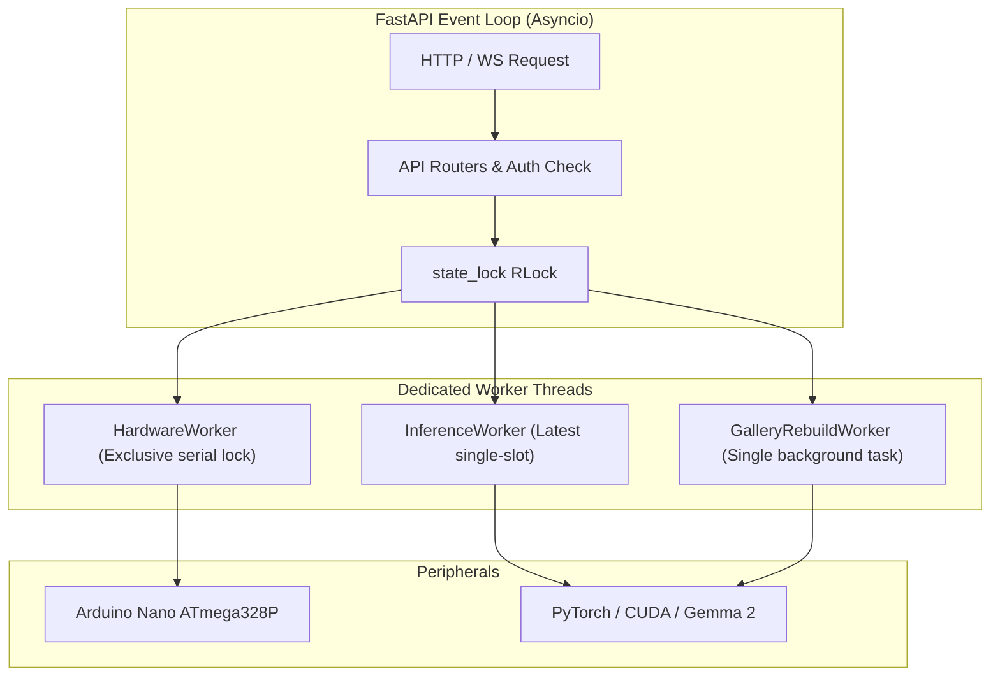

# ToolLighthouse: Diseño de Arquitectura para Configuración y Calibración Integral

**Fecha:** 2026-10-14  
**Estado:** Propuesta de arquitectura (Lead AGY)  
**Alcance:** Transformar el dashboard React en una aplicación de inspección, calibración, configuración y diagnóstico para ToolLighthouse, manteniendo la arquitectura local React + FastAPI + OpenCV + EmbeddingGemma 2 + Arduino Nano sin dependencias externas pesadas ni cambios de modelo.

---

## 1. Contexto, Diagnóstico y Estado Actual

### 1.1 Estado del Repositorio y Entorno
- **Commit base:** `b307553` ("fix: default EmbeddingGemma galleries to text-only zero-shot").
- **Rama:** `main` (limpia, sincronizada con origin).
- **Entorno de ejecución verificado:**
  - Backend: Python 3.11 en `.venv`, `pytest-9.1.1` (108 passed, 1 skipped).
  - Frontend: Node / Vite 8.3.4 / React 19 / TypeScript 7.0.2 (15 vitest passed, build limpio de 243 kB JS / 8.1 kB CSS).
  - Firmware: Código fuente Arduino Nano ATmega328P (`firmware/nano/nano.ino`), 115200 baud, watchdog 2500 ms, protocolo `MASK:N` / `ACK:N`. (Nota: No se afirma verificación física de hardware ni compilación en este entorno en ausencia del comando del toolchain/hardware conectado).

### 1.2 Bloqueadores de Inicio y Brechas Identificadas
1. **Bloqueador de arranque en modo real:**
   - En `src/toollighthouse/pipeline.py` (L40-44 y L61-68), el constructor `Pipeline.__init__` lanza `FileNotFoundError` si no existe la imagen de fondo de calibración (`background.png`), o `RuntimeError` si la galería no existe o no tiene referencias.
   - *Impacto:* El backend no puede arrancar en modo real para permitir que el usuario calibre o configure el sistema desde el dashboard por primera vez.
   - *Solución:* Modo de preparación seguro (`preparation` / `uncalibrated`), donde el backend inicia con capacidades administrativas activas, reporta el estado de preparación y restringe únicamente los endpoints de inferencia hasta que los requisitos estén satisfechos.
2. **Restricción estricta en galería híbrida:**
   - En `src/toollighthouse/gallery.py` (L82-86), `build_gallery` exige que las imágenes de referencia cubran exactamente las nueve categorías (`image_class_ids != expected_ids`).
   - *Impacto:* No permite agregar fotos a 1, 2 o 5 herramientas progresivamente en modo híbrido.
   - *Solución:* Galería híbrida parcial: si una categoría tiene imágenes, su prototipo se combina con peso ponderado `_unit(w * text + (1-w) * image)`; si no tiene fotos, conserva su prototipo zero-shot de solo texto. La validación de caché y `references_fingerprint` deben incorporar este esquema parcial sin errores.
3. **Ausencia de persistencia y mutación dinámica de configuración:**
   - `Settings` e `Inventory` se leen en frío al inicio desde archivos JSON o CLI.
   - *Impacto:* Cualquier cambio en descripciones, nombres o ubicaciones requiere editar archivos en disco o reiniciar el proceso.
   - *Solución:* Capa de configuración con persistencia atómica en disco (`config/app_config.json` con `.backup.json`), diferenciación entre estado persistido vs estado activo, y aplicación en caliente transaccional con reversión (rollback).
4. **Falta de control administrativo segregado:**
   - `SessionStore` solo diferencia `controller` y `reader`. Un `controller` (cualquier teléfono emparejado) puede actualmente disparar calibración de fondo.
   - *Solución:* Rol administrativo explícito (`admin`) con clave administrativa independiente (`X-Admin-Key`) para mutaciones estructurales (inventario, galería, puerto Arduino, cambio de modo).
5. **Aislamiento de hardware y diagnóstico:**
   - `SerialTransport` usa un puerto COM fijo sin enumeración dinámica de puertos (`serial.tools.list_ports`). No existe modo de mantenimiento para pruebas unitarias de LEDs con apagado automático ni reporte verídico de ACK durante diagnóstico.

---

## 2. Decisiones Arquitectónicas y Principios de Diseño

1. **Backend como Fuente de Verdad Unificada:**
   - El backend Python gestiona y valida todo el estado crítico: inventario (9 categorías), parámetros de clasificador, pesos, rutas de fotos de referencia y estado de hardware en un sobre atómico versionado (`config/app_config.json`).
   - React nunca almacena estado canónico en `localStorage` (solo preferencias volátiles de UI como URL del backend y device ID).
2. **Nueve Categorías Estables y Mapeo Físico Invariante:**
   - Exactamente 9 categorías con identificadores internos estables (`class_id`). No se fuerza a migrar inventarios preexistentes a `tool_1..tool_9`; se admiten identificadores opacos arbitrarios seguros para el sistema de archivos (`^[a-zA-Z0-9_-]{1,64}$`), rechazando `..` y separadores de ruta.
   - Separación estricta entre nombre de visualización y texto de clasificación: `name` y `descriptions` determinan la huella y los embeddings; `display_name` (opcional) es exclusivo de visualización en UI y permite renames seguros sin reconstruir embeddings.
   - Mapeo biyectivo y estricto: cada herramienta tiene un `led_index` único en `0..8` y su correspondiente pin físico `pin = led_index + 2` (`D2..D10`).
   - Se admiten intercambios de asignación desde la UI, pero el backend valida y rechaza cualquier colisión o duplicidad antes de persistir o aplicar.
3. **Modos de Reconocimiento y Transición Gradual:**
   - **Solo texto (predeterminado):** Prototipos generados exclusivamente a partir de `name` y `descriptions`. No requiere fotografías.
   - **Texto + imágenes (híbrido):** Permite subir fotos a un subconjunto arbitrario de categorías (0 a 9). Las categorías sin fotos usan solo texto.
   - **Solo imágenes (avanzado):** Requiere imágenes para las 9 categorías (modo diagnóstico/evaluación).
4. **Transaccionalidad en Reconstrucción y Hot-Apply:**
   - Reconstrucción asíncrona de embeddings en worker dedicado sin bloquear el bucle de eventos (`asyncio`) de FastAPI.
   - Si la reconstrucción falla, se preserva intacta la galería activa anterior y se reporta el error con diagnóstico detallado.
   - Al aplicar una nueva configuración activa:
     1. Se drena y descarta cualquier inferencia en curso.
     2. Se envía `MASK:0` al Arduino y se confirma apagado físico.
     3. Se incrementa la cerca de generación de escena (`scene_generation += 1`), invalidando cualquier resultado en vuelo.
     4. Se reinicia el rastreador (`tracker.reset()`) y caché de predicciones.
     5. Se intercambian atómicamente el clasificador y la configuración en `Pipeline`.
5. **Modo de Mantenimiento de Arduino:**
   - Exclusividad mutua: mientras el modo de mantenimiento esté activo, los endpoints de inferencia (`/v1/analyze/photo` y `/v1/stream/frame`) devuelven `409 Conflict`.
   - Pruebas unitarias de LED temporizadas: encendido de un único LED con apagado automático garantizado tras $T \le 3.0\,\text{s}$.
   - Prohibido encender los 9 LEDs simultáneamente como prueba inicial de cableado.
   - Veracidad física de ACK: solo se reporta estado confirmado si el microcontrolador devolvió `ACK:N`.

---

## 3. Modelo de Datos y Contratos de la API

### 3.1 Estructuras de Datos Centrales

```python
# src/toollighthouse/config.py

@dataclass(frozen=True)
class ToolCategory:
    class_id: str             # 'tool_1'..'tool_9' (estable)
    name: str                 # Nombre visible editable
    location: str             # Ubicación física editable
    led_index: int            # 0..8 único
    pin: int                  # led_index + 2 (D2..D10)
    descriptions: tuple[str, ...] = ()
    reference_count: int = 0  # Cantidad de imágenes asociadas en disco

@dataclass
class SystemReadiness:
    backend_ok: bool
    python_version: str
    torch_available: bool
    cuda_available: bool
    gpu_name: str | None
    vram_free_mb: int | None
    model_present: bool
    model_status: str         # 'ready' | 'missing' | 'loading' | 'error'
    inventory_ready: bool     # 9 categorías válidas y confirmadas
    gallery_ready: bool       # Caché compilada y compatible
    calibration_ready: bool   # Fondo y ROI configurados
    arduino_ready: bool       # Conectado o simulación seleccionada
    active_mode: str          # 'mock' | 'preparation' | 'real'
    can_activate_real: bool
```

### 3.2 Endpoints Propuestos (Extensiones a `/v1`)

| Método | Endpoint | Rol Mínimo | Descripción |
|---|---|---|---|
| `GET` | `/v1/system/readiness` | `reader` | Estado detallado de dependencias, GPU, modelo, fondo y Arduino. |
| `POST` | `/v1/system/mode` | `admin` | Conmuta entre `mock`, `preparation` y `real` (valida readiness). |
| `POST` | `/v1/system/download-model` | `admin` | Inicia descarga controlada de `EmbeddingGemma 2` en background. |
| `GET` | `/v1/config` | `reader` | Obtiene configuración persistida vs activa, versiones y dirty state. |
| `PUT` | `/v1/config` | `admin` | Valida y persiste configuración (inventario, parámetros, modos). |
| `POST` | `/v1/config/apply` | `admin` | Compila galería si es necesario y aplica en caliente al pipeline. |
| `POST` | `/v1/config/rollback` | `admin` | Restaura la configuración persistida anterior. |
| `GET` | `/v1/config/export` | `admin` | Exporta archivo JSON portable (sin rutas absolutas ni secretos). |
| `POST` | `/v1/config/import` | `admin` | Importa y valida configuración portable. |
| `GET` | `/v1/tools/{class_id}/references` | `reader` | Lista metadatos de fotos de referencia para una categoría. |
| `POST` | `/v1/tools/{class_id}/references` | `admin` | Sube fotografía de referencia (validación MIME, EXIF, límite 12 MB). |
| `DELETE` | `/v1/tools/{class_id}/references/{image_id}` | `admin` | Elimina fotografía de referencia específica. |
| `GET` | `/v1/calibration` | `reader` | Metadatos de calibración: dimensiones fondo, ROI `[x,y,w,h]`. |
| `GET` | `/v1/calibration/background.jpg` | `reader` | Imagen JPEG del fondo actual para visualizador del dashboard. |
| `PUT` | `/v1/calibration/roi` | `admin` | Actualiza coordenadas de ROI dibujado en canvas sin resubir foto. |
| `GET` | `/v1/arduino/ports` | `admin` | Lista puertos COM detectados por `pyserial`. |
| `POST` | `/v1/arduino/connect` | `admin` | Conecta o reconecta al puerto COM seleccionado. |
| `POST` | `/v1/arduino/disconnect` | `admin` | Cierra conexión serial de forma segura (`MASK:0`). |
| `POST` | `/v1/arduino/maintenance/enter`| `admin` | Entra a modo mantenimiento (bloquea inferencia, apaga LEDs). |
| `POST` | `/v1/arduino/maintenance/leave`| `admin` | Sale de modo mantenimiento y restaura operación normal. |
| `POST` | `/v1/arduino/maintenance/test-led/{idx}` | `admin` | Prueba LED individual con temporizador de auto-apagado. |
| `POST` | `/v1/arduino/maintenance/all-off` | `admin` | Envía `MASK:0` inmediato en modo mantenimiento. |

### 3.3 Eventos WebSocket (`/v1/ws`)

Se preservan los eventos existentes (`detection`, `arduino_ack`, `system`) y se estandarizan nuevos subtipos:
- `system / config_changed`: Notifica cambio en configuración persistida o dirty state.
- `system / gallery_building`: Progreso porcentual y etapa de cálculo de embeddings.
- `system / gallery_ready`: Galería compilada con éxito, lista para aplicar.
- `system / gallery_error`: Detalle del fallo en cálculo de embeddings.
- `system / maintenance_mode`: Notifica entrada/salida de modo mantenimiento.
- `system / model_download_progress`: Progreso de descarga de pesos del modelo.

---

## 4. Límites de Workers y Orden de Concurrencia



### Invariantes de Seguridad y Concurrencia
1. **Exclusión GPU:** `InferenceWorker` y `GalleryRebuildWorker` comparten el candado de GPU (`_lock` en `EmbeddingEngine`). La reconstrucción de galería se realiza en background sin bloquear peticiones I/O del servidor, pero pausa momentáneamente nuevas inferencias durante la compilación de lotes.
2. **Exclusión Serial y Mantenimiento:**
   - La inferencia nunca envía comandos seriales si `maintenance_mode == True`.
   - El modo mantenimiento adquiere `state_lock`, fuerza `MASK:0`, limpia el estado de escena y toma posesión del canal serial.
3. **Validación de Subidas y Sanitización de Archivos:**
   - Carga de imágenes limitada a `max_upload_bytes = 12 MB` y `max_pixels = 20_000_000`.
   - Nombres de archivo sanitizados: UUIDv4 + extensión validada (`.jpg`, `.jpeg`, `.png`, `.webp`).
   - Rutas confinadas estrictamente dentro de `data/references/{class_id}/` evitando cualquier secuencia `..` o caracteres de escape de directorio (prevención rigurosa de Path Traversal).

---

## 5. Diseño del Dashboard Frontend (React + TypeScript)

### 5.1 Estructura de Navegación y Responsive Layout
- **Mobile (< 768px):** Barra de navegación fija inferior con 5 iconos táctiles y etiquetas concisas.
- **Desktop (>= 768px):** Barra lateral izquierda o cabecera compacta con acceso rápido.
- **Botón global persistente:** Botón de retorno directo a "Inspección" accesible desde cualquier pantalla.
- **Banner de cambios pendientes:** Indicador superior discreto cuando hay ajustes guardados sin aplicar ("Guardar y aplicar").

### 5.2 Secciones de la Aplicación

1. **Inspección (Preservar y extender):**
   - Fotografía normalizada, cajas SVG superpuestas coincidentes con dimensiones normalizadas.
   - Panel de detecciones, tracks y similitudes.
   - Mapa de luces con indicación de estado solicitado vs confirmado (ACK verídico).
2. **Herramientas (Editor de Categorías):**
   - Vista de 9 tarjetas editables y mapa físico de cuadrícula interactivo.
   - Campos: Nombre visible, `class_id` estable, lista de descripciones (añadir/quitar), ubicación, selector de LED (0..8) y Pin correspondiente.
   - Guía visual breve integrada: forma, textura, color, partes distintivas.
   - Galería de miniaturas por herramienta: contador, previsualización, botón de subir foto (cámara o archivo) y eliminación individual.
   - Validación visual inmediata si hay colisión de LEDs o datos incompletos.
3. **Calibración (IA y Bandeja):**
   - Selector de modo: Solo texto (default), Texto + imágenes (híbrido) con toggle intuitivo "Mejorar con fotografías", y Solo imágenes (avanzado).
   - Control deslizante para peso relativo texto/imagen en modo híbrido.
   - Visualizador de fondo guardado y herramienta de recorte ROI interactiva (dibujo de rectángulo sobre el fondo de la bandeja).
   - Guía de estabilidad de cámara e iluminación.
4. **Arduino (Diagnóstico de Hardware):**
   - Selector desplegable de puertos COM descubiertos con botón de refrescar.
   - Botón conectar / desconectar con estado visual.
   - Interruptor seguro para "Modo Mantenimiento".
   - 9 botones individuales para probar LEDs (D2 a D10) con temporizador visual regresivo de auto-apagado.
   - Botón de emergencia "Apagar todos".
   - Guía de carga de firmware (`nano.ino`) y solución de problemas de bootloader.
5. **Sistema (Asistente y Estado):**
   - Asistente de primera configuración (Checklist interactivo de 7 puntos con indicadores de estado en tiempo real).
   - Tarjetas de diagnóstico: GPU / VRAM, estado de `EmbeddingGemma 2`, estado de backend, versión de configuración activa vs guardada.
   - Botón de descarga controlada del modelo si no está presente.
   - Exportación e importación de configuración portable en formato JSON.

---

## 6. Estrategia de Entrega en 3 Asignaciones Secuenciales

- **Asignación 1 (Backend Core, Ciclo de Vida y Seguridad):**
  - Modelos de configuración, persistencia atómica, rollback, export/import.
  - Soporte de galería híbrida parcial en `gallery.py` y `embeddings.py`.
  - Modo preparación en `pipeline.py` y endpoints de diagnóstico/readiness.
  - Mantenimiento y diagnóstico serial en `serial_transport.py` y `app.py`.
  - Transaccionalidad de hot-apply con apagado de LEDs y fences de generación.
  - Tests unitarios y de integración de backend.
- **Asignación 2 (Dashboard Móvil, Componentes e Integración):**
  - Reestructuración de navegación (Bottom nav mobile / sidebar desktop).
  - Componentes de las 5 secciones: `ToolManager`, `CalibrationView`, `ArduinoPanel`, `SystemPanel`, `InspectionView`.
  - Integración de canvas ROI interactivo y subida múltiple de fotos de referencia.
  - Conexión con endpoints `/v1` y eventos WebSocket de progreso.
  - Tests frontend en Vitest y verificación de build con Vite.
- **Asignación 3 (Revisión Independiente, Verificación, Docs y Cierre):**
  - Suite de pruebas E2E con datos simulados (ciclo completo de configuración, calibración, hot-apply y análisis).
  - Auditoría de seguridad (revisión estricta de path traversal, auth de admin, expiración de lease, prevención de inferencias obsoletas).
  - Actualización exhaustiva de documentación (`README.md`, `docs/API.md`, `docs/COMMANDS.md`, guía de configuración).
  - Verificación final de CI (`pytest`, `npm test`, `npm run build`, `arduino-cli compile`).
